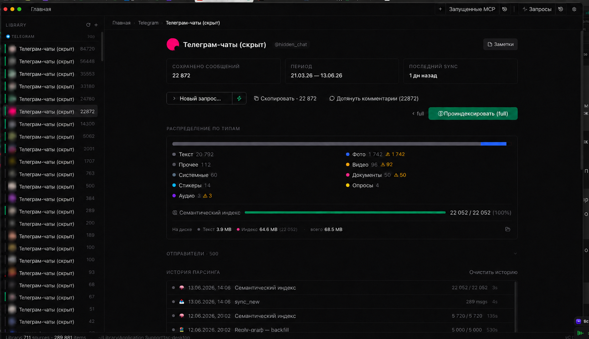

# SC Desktop

<p align="center">
  
</p>

SC Desktop is a macOS Electron app plus MCP host for collecting, indexing, and reusing social/chat data in local AI workflows. It sits between raw sources and the agent: Telegram chats, Reddit threads, browser-only research flows, semantic search, then MCP tools on top of the same local library.

The project is not just a viewer. It is the orchestration layer around a local data pipeline: Electron for the UI and jobs, Python workers for source fetches, a browser extension for sites that only work inside a real logged-in browser, and an MCP server that exposes the resulting archive back to Claude/Codex and other desktop AI tools.

## Related Repositories

- [AI Mac Electron](https://github.com/RevinFedor/ai-mac-electron) — desktop AI chat/voice app that uses SC Desktop MCP for Telegram, Reddit, and attached file workflows.
- [docs_search MCP](https://github.com/RevinFedor/docs_search_mcp) — semantic documentation router used across this project and the adjacent Electron apps.
- [custom-terminal](https://github.com/RevinFedor/custom-terminal) — Claude/Codex terminal orchestrator in the same local AI stack.
- [GT Editor](https://github.com/RevinFedor/gt-editor) — markdown workspace whose files and notes also participate in the broader MCP workflow.

## What It Does

- Imports Telegram chats through Telethon-backed Python workers, including preview, catch-up, indexing, and multi-session account handling.
- Fetches Reddit search results and thread trees through free cookie-backed `.json` endpoints, with explicit paid fallback paths when needed.
- Runs browser-only flows through a real browser extension for AI Studio, Claude, Perplexity, and YouTube cases that a plain CLI cannot parse reliably.
- Stores everything in a local library, builds semantic indexes, and exposes search/fetch/read tools through `mcp/server.js`.
- Gives the user one desktop UI for source inventory, parse history, semantic coverage, MCP jobs, and research results.

## Architecture

SC Desktop has four working parts:

- **Electron app** — the visible desktop shell: library sidebar, center screens, activity/history, job progress, settings, semantic index controls.
- **`python-workers/` Python workers** — Telegram/Reddit/YouTube/TikTok/Instagram/local fetchers that emit ndjson and write into the same library.
- **`browser-extension/`** — the real-browser parser bridge for AI Studio, Claude, Perplexity, YouTube, and other cookie/CSP-protected flows.
- **`mcp/server.js`** — the MCP layer that lets another agent query the same local archive instead of screen-scraping the UI.

The practical result is one local data bus: UI and MCP read the same library, jobs update one activity stream, and semantic search runs on top of the same stored items.

## Current State

As a codebase, `sc-desktop` is already structured as the main desktop shell for the whole system.

The desktop runtime is self-contained for the worker code that Electron launches:

- Python workers live in `python-workers/`, not in the old `cli-tools` submodule.
- Electron resolves workers from `python-workers/` in dev and from app resources in packaged builds.
- Service keys are read from environment variables or `~/.config/sc/settings.json`.
- Telegram session files and runtime data stay under `~/Library/Application Support/sc-desktop/`.

A fresh checkout still needs normal local setup: Node dependencies, a local Python environment from `python-workers/requirements.txt`, and user-specific credentials/sessions. The browser extension is now tracked directly in this repository under `browser-extension/` (previously a git submodule link), so a clone gets its source without a separate fetch. Its own machine-specific material — runtime logs, the signing private key, and the generated native-messaging wrapper — stays untracked through the extension's `.gitignore`.

## MCP Workflows

This repository is heavily MCP-oriented.

`mcp/server.js` exposes Telegram semantic search, Telegram neighbors/reply-graph tools, Reddit search/thread tools, Twitter/X tools, and GT Editor-related access from the same desktop runtime. In practice this is the layer that lets an external AI ask things like:

- "find the relevant messages in this Telegram chat"
- "pull this Reddit thread and give me the comment tree"
- "open or read the exact file I need from the local workspace"

That same MCP surface is also used by `AI Mac Electron`, so the desktop AI chat can call into SC Desktop instead of reimplementing Telegram/Reddit/browser parsing on its own.

## Browser MCP And App Dependency

There are two separate browser bridges, and they depend on the desktop app differently. This distinction matters when deciding whether SC Desktop has to be running.

**Live browser automation (`mcp__browser__*`) does not need the app.** Tools like `list_tabs`, `click`, `fill`, `evaluate`, and `snapshot` flow through a standalone bridge:

```
Agent → mcp/browser/index.js → bridge.js (ws :3458 → :3457) → extension → DOM
```

`bridge.js` is its own Node process. It auto-spawns on the first tool call, is shared by all agent sessions, and keeps running after SC Desktop closes. For this path you only need a Chromium-based browser open with the extension enabled — the desktop app can be fully quit.

**Deeper flows do need SC Desktop running.** The app itself hosts a second bridge in `electron/browser-bridge.js`, bound to loopback `127.0.0.1`:

- `:53127` — HTTP bridge for research channels (`/research-start`, polled `/research-status`) and `/yt-fetch`, plus writes back into the local library.
- `:53129` — WebSocket channel that hot-reloads the extension after edits to `browser-extension/*.js`.

Without the app, those endpoints have no listener: research runs cannot start, fetched data is not persisted, and extension hot-reload falls back to manual reload.

Rule of thumb: ad-hoc browsing and DOM parsing → browser + extension only; long-running research, persistence into `library.db`, and auto hot-reload → SC Desktop must be running.

## Telegram / Reddit / Browser Parsing

Telegram is the deepest path in the project: local session-aware fetches, preview-only runs, incremental catch-up, semantic indexing, and MCP search over the same archive.

Reddit has a strict cost model: free cookie-backed API mode by default, explicit `auto`/`apify` paid fallback only when chosen on purpose. This matters because SC Desktop is built to preserve deterministic local workflows and not silently spend money when a free path fails.

The browser extension exists for the cases where CLI and public APIs are not enough: AI Studio, Perplexity, Claude chat export, YouTube-to-AI handoff, and other flows that need a real logged-in browser with real cookies and DOM state.

## Install On Mac

Requirements:

- macOS
- Node.js 18+
- Python 3 for the worker scripts
- `jq` for the docs/indexer tooling
- a checkout where `browser-extension/` is present for browser-only flows
- local runtime config in environment variables or `~/.config/sc/settings.json`

Install desktop dependencies:

```bash
npm install
```

Create the local Python environment for workers:

```bash
npm run python:setup
```

Run in development:

```bash
npm run dev
```

Build and install into `/Applications`:

```bash
npm run build:install
```

If `better-sqlite3` ABI drifts after an Electron upgrade:

```bash
npm run rebuild
```

## Browser Extension Setup

The extension is a required part of the full workflow, not an optional demo.

Bootstrap the Native Messaging Host:

```bash
cd browser-extension
node nmh/setup.js
```

Then open your Chromium-based browser, go to the extensions page, and load `browser-extension/` unpacked.

After extension code changes:

- reload the extension in the browser
- reload the target tabs if the content-script set changed

## Local Config And Data

Runtime state is local:

- `~/Library/Application Support/sc-desktop/library.db`
- `~/Library/Application Support/sc-desktop/jobs/`
- `~/Library/Application Support/sc-desktop/output/`
- `~/Library/Application Support/sc-desktop/sessions/`
- `~/.config/sc/settings.json`

Service keys can be provided through environment variables or the shared settings file. Live keys, session files, browser cookies, generated job output, and local databases are runtime material and should not be published.

## Documentation Search MCP

This project actively relies on [docs_search MCP](https://github.com/RevinFedor/docs_search_mcp). The codebase has enough Telegram/Reddit/browser/MCP-specific scars that a generic agent will miss important constraints if it only reads `README.md`.

The intended flow is:

1. the agent calls `docs_search`
2. it receives the relevant `fact-*`, `fix-*`, and methodology files from `.semantic-index.json`
3. only then it edits code or reasons about the pipeline

After documentation changes, rebuild the index through MCP `docs_reindex` with this repository as `projectPath`. Repo-local shell indexers are not used.

## Repository Notes

The old `cli-tools` tree is no longer a runtime dependency of the desktop app. The worker scripts Electron launches are tracked in `python-workers/`, and generated output is intentionally kept outside the repository.

`browser-extension/` is now vendored directly into this repository (it used to be a submodule gitlink with no `.gitmodules`, which rendered as a dead link and shipped no files). It is required for the browser-only workflows, while Telegram, Reddit, YouTube/TikTok worker launches, local transcription, and Instagram worker entry points live in this repository.

## Security

The desktop app and MCP server are local-first. The important boundary is not "does the repo mention a host or a path", but "does it publish live tokens, session files, or keys that allow someone else to act as the user".

For this repo family, the critical things that must stay local are:

- service keys
- Telegram session files
- browser cookies
- local config with runtime secrets

The repo should describe these files and workflows, but not publish their live contents.

> ! Documentation is routed through `docs_search MCP`: agents call `docs_search`, receive relevant files from `.semantic-index.json`, and read those files into context before non-trivial code changes.
